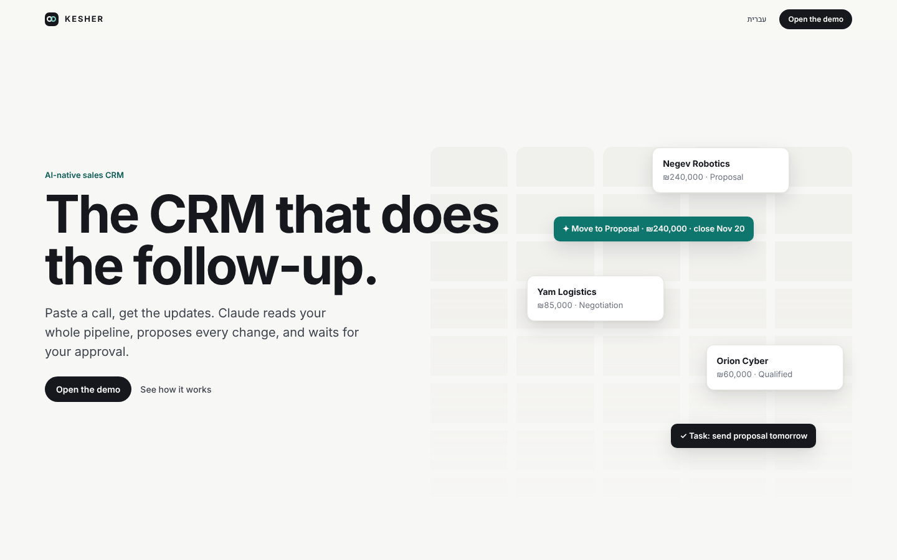
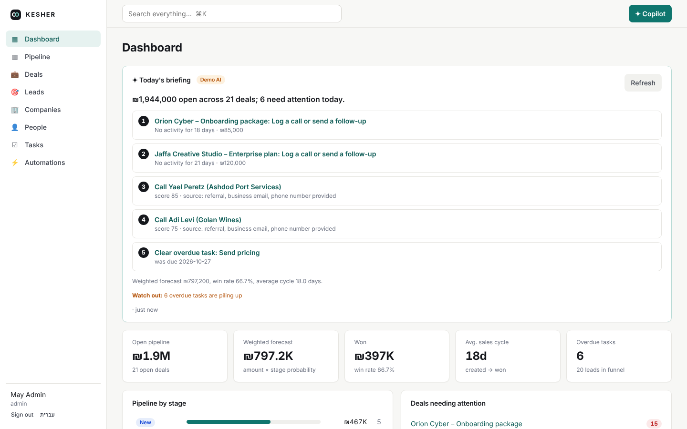
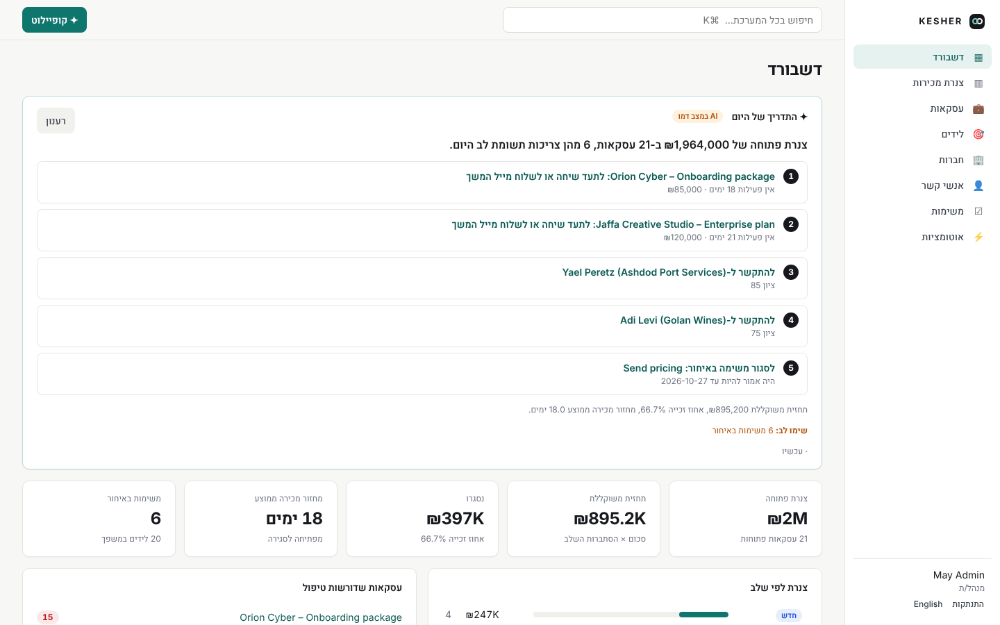

<div dir="rtl">

# KESHER CRM

**מערכת CRM למכירות שבנויה סביב AI. מדביקים סיכום שיחה ומאשרים את העדכונים. Claude קורא את כל הצנרת, נותן תדריך בכל בוקר, מנתח לידים חדשים עוד לפני שפתחת אותם, ומציע כל שינוי, שמתבצע רק אחרי אישור שלך. מתחת לזה יש ליבה מבוססת אירועים: כל שינוי נרשם בטיימליין, יכול להפעיל אוטומציות, ומזין דירוג לידים ובריאות עסקאות. הממשק בעברית (RTL) ובאנגלית.**

[English](README.md)



## AI בליבה (Claude Opus 5.5)



- **התדריך של היום**: Claude קורא תמונת מצב של הצנרת (בריאות עסקאות, העסקאות הגדולות, משימות באיחור, לידים חמים ותחזית) ומחזיר כותרת ו-3 עד 5 משימות פוקוס, כל אחת עם קישור לרשומה שלה.
- **קופיילוט**: סוכן שיחה עם כלים על כל ה-CRM. הוא מחפש, קורא רשומות וטיימליין ובודק את הצנרת לבד. כל כתיבה (יצירה ועדכון של רשומות, משימות, הערות, המרת ליד) מחכה לאישור שלך. מדביקים סיכום שיחה והוא מציע שלב, סכום, תאריך סגירה, הערה ומשימת המשך.
- **ניתוח יזום ברקע**: כשנוצר ליד או כשעסקה משנה שלב, נכנסת לתור משימת ניתוח, כך שהתובנה כבר מחכה כשפותחים את הרשומה.
- **תובנת AI לכל רשומה**: סיכום, מומנטום, סיכונים, צעדים הבאים שהופכים למשימה בלחיצה, וטיוטת מייל, בעברית או באנגלית.
- **אוטומציות בשפה חופשית**: מתארים כלל בעברית או באנגלית, Claude מנסח טריגר, תנאים ופעולות, והמנוע בודק את הטיוטה לפני השמירה.
- **צעד AI בתוך אוטומציה**: כלל יכול להעביר רשומה ל-Claude עם הוראות. הצעד רץ ברקע, כך ששמירת רשומה לא מחכה למודל.
- **תיעוד מלא**: כל מה שה-AI משנה מופיע בטיימליין עם תג ✦ AI והשוואה ברמת השדה.

**אפשר לנסות בלי מפתח API.** בלי `ANTHROPIC_API_KEY` פיצ'רי ה-AI רצים ב*מצב דמו*: תחליף לא מקוון שמדבר באותו ממשק ומפעיל את אותה לולאת סוכן, כרטיסי אישור, משימות רקע ופלט מובנה, עם כללים פשוטים על נתוני ה-CRM. כל מה שהוא מפיק מסומן **AI במצב דמו**. עם מפתח, אותם מסכים עובדים עם Claude. צילומי המסך כאן צולמו במצב דמו.



## מה יש במערכת
- **חברות, אנשי קשר, לידים, עסקאות, משימות והערות**: יצירה, עריכה ומחיקה, סינון ומיון, וחיפוש גלובלי (⌘K).
- **צנרת קנבן**: גרירה בין שלבים ובתוך עמודה, כל הזזה היא כתיבה אחת.
- **טיימליין לכל רשומה**: מי שינה מה ומתי, כולל לפני ואחרי ברמת השדה.
- **המרת ליד**: בלחיצה אחת הליד הופך לחברה, איש קשר ועסקה.
- **דירוג לידים שמסביר את עצמו** (0 עד 100, דרגות A עד D): כל נקודה מגיעה עם סיבה.
- **בריאות עסקה**: התראות על עסקה תקועה, תאריך סגירה שעבר, חוסר באיש קשר או בצעד הבא, ולכל אחת פעולה מומלצת.
- **בונה אוטומציות**: כשקורה X, אם מתקיים Y, אז משימה, הערה, עדכון שדה, Webhook או צעד AI. עם יומן הרצות והגנה מלולאות.
- **דשבורד**: צנרת פתוחה, תחזית משוקללת, אחוז זכייה, מחזור מכירה, משפך, המרה לפי מקור ופעילות יומית.
- **דף מוצר עם גלילה**: חמש מערכות שמסבירות את המוצר ומסתיימות בטופס הכניסה, עם גרסה סטטית למי שמבקש פחות תנועה וקומפוזיציה נפרדת למובייל.
- **נגישות**: דיאלוגים עם ניהול פוקוס, דיאלוג אזהרה לפעולות מחיקה, ניווט מלא במקלדת ותוויות לכל כפתור אייקון.

## איך זה נבנה
כל כתיבה במערכת עוברת דרך שכבת שירות אחת שמפיקה אירוע. הטיימליין, דירוג הלידים, האוטומציות והניתוח היזום של ה-AI הם מאזינים עצמאיים. החלטות התכנון מפורטות ב-[docs/design.md](docs/design.md).

**סטאק:** Python, FastAPI, SQLAlchemy 2, SQLite/Postgres, React 18, TypeScript ו-Vite, Claude Opus 5.5 דרך Anthropic SDK, עם 30 בדיקות End-to-End ו-CI בכל דחיפה.

## הרצה
```bash
docker compose up --build   # http://localhost:8000
# משתמש דמו: admin@kesher.dev / demo1234
# ה-AI רץ במצב דמו; כדי לעבוד עם Claude מגדירים ANTHROPIC_API_KEY
```

</div>
