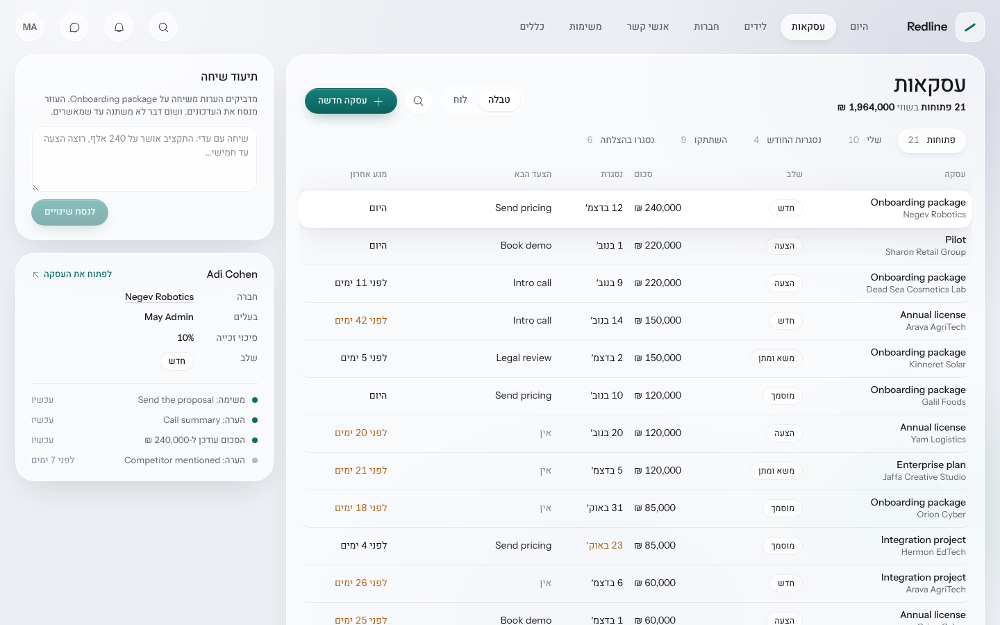
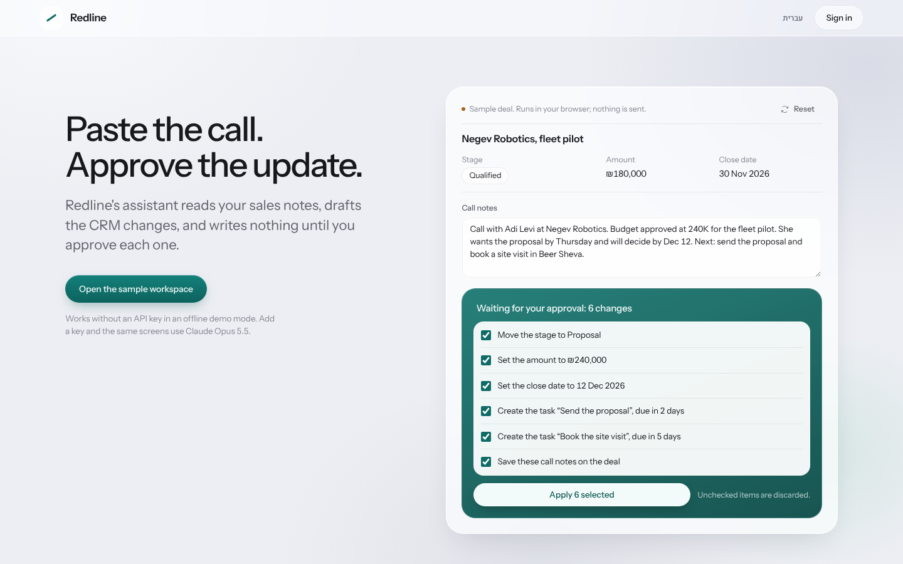

<div dir="rtl">

# Redline CRM

**מערכת CRM למכירות, עם עוזר ששואל לפני שהוא כותב.** מדביקים את סיכום השיחה, והעוזר מנסח את העדכונים: שלב, סכום, תאריך סגירה ומשימת המשך. שום דבר לא נשמר עד שמאשרים כל שינוי. בכל בוקר הוא כותב מזכר קצר: מאיפה להתחיל היום. מתחת לזה יש ליבה מבוססת אירועים: כל שינוי נרשם בציר הזמן עם המקור שלו, יכול להפעיל כללים, ומזין דירוג לידים ובריאות עסקאות. הממשק בעברית (RTL) ובאנגלית.

[English](README.md)



## העוזר (Claude Opus 5.5)

- **שינויים משיחה, בתוך הטבלה**: מדביקים הערות משיחה על עסקה, והעוזר מציע שלב, סכום, תאריך סגירה, הערה ומשימה הבאה. ההצעות מופיעות בתאים של טבלת העסקאות (הערך הישן מחוק, החדש מסומן בקו) ומחכות בכרטיס אישור, וכל שדה אפשר לאשר בנפרד.
- **המזכר של הבוקר**: העוזר קורא תמונת מצב של הצנרת (בריאות עסקאות, העסקאות הגדולות, משימות באיחור, לידים חמים ותחזית) וכותב משפט פתיחה ושלוש עד חמש נקודות ממוספרות, כל אחת עם קישור לרשומה שלה. המזכר נשמר לפי שפה.
- **חלונית העוזר**: סוכן שיחה עם כלים על כל ה-CRM. הוא מחפש, קורא רשומות וציר זמן ובודק את הצנרת לבד. כל כתיבה (יצירה ועדכון של רשומות, משימות, הערות, המרת ליד) מחכה לאישור שלך.
- **קריאה יזומה ברקע**: כשנוצר ליד או כשעסקה משנה שלב, העוזר מכין את הקריאה שלו מראש, כך שהיא כבר מחכה כשפותחים את הרשומה.
- **הקריאה של העוזר בכל רשומה**: סיכום, מומנטום, סיכונים, צעדים הבאים שהופכים למשימה בלחיצה, וטיוטת מייל, בעברית או באנגלית.
- **כללים בשפה חופשית**: מתארים כלל בעברית או באנגלית, העוזר מנסח טריגר, תנאים ופעולות, והמנוע בודק את הטיוטה לפני השמירה.
- **מקור לכל שינוי**: בציר הזמן רואים מי שינה מה, ידנית, דרך כלל, בייבוא או דרך העוזר, עם הערך לפני ואחרי.

**אפשר לנסות בלי מפתח API.** בלי `ANTHROPIC_API_KEY` העוזר רץ ב*מצב דמו*: תחליף לא מקוון שמדבר באותו ממשק ומפעיל את אותה לולאת סוכן, רשימת אישורים, משימות רקע ופלט מובנה. כל מה שהוא כותב מסומן כטיוטה של עוזר הדמו. עם מפתח, אותם מסכים עובדים עם Claude. צילומי המסך כאן צולמו במצב דמו.



## מה יש במערכת
- **חברות, אנשי קשר, לידים, עסקאות, משימות והערות**: יצירה, עריכה ומחיקה, סינון ומיון, וחיפוש גלובלי (Ctrl K).
- **עסקאות כטבלה או כלוח**: תצוגות שמורות (פתוחות, שלי, נסגרות החודש, השתתקו, נסגרו), הצעד הבא והמגע האחרון בכל שורה, ולוח עם גרירה בין שלבים, כל הזזה היא כתיבה אחת.
- **ציר זמן לכל רשומה**: מי שינה מה ומתי, כולל לפני ואחרי ברמת השדה.
- **המרת ליד**: בלחיצה אחת הליד הופך לחברה, איש קשר ועסקה.
- **דירוג לידים עם סיבות** (0 עד 100, דרגות A עד D): כל נקודה מגיעה עם הסיבה שלה.
- **בריאות עסקה**: התראות על עסקה תקועה, תאריך סגירה שעבר, חוסר באיש קשר או בצעד הבא, ולכל אחת פעולה מומלצת.
- **כללים בלי קוד**: כשקורה X, אם מתקיים Y, אז משימה, הערה, עדכון שדה, Webhook או צעד של העוזר. כל כלל מוצג כמשפט קריא, עם יומן הרצות והגנה מלולאות.
- **מסך היום**: המזכר, עסקאות שדורשות טיפול, צנרת פתוחה, תחזית משוקללת, אחוז זכייה, מחזור מכירה, ערך לפי שלב והמרה לפי מקור.
- **ערכת צבעים בהירה וכהה**, או לפי הגדרות המערכת.
- **נגישות**: דיאלוגים עם ניהול פוקוס, דיאלוג אזהרה למחיקה, ניווט מלא במקלדת, תוויות לכל כפתור אייקון, וניגודיות צבעים ברמת WCAG AA בשתי הערכות.

## איך זה נבנה
כל כתיבה במערכת עוברת דרך שכבת שירות אחת שמפיקה אירוע. ציר הזמן, דירוג הלידים, הכללים והקריאה היזומה של העוזר הם מאזינים עצמאיים. החלטות התכנון מפורטות ב-[docs/design.md](docs/design.md), והממשק ב-[DESIGN.md](DESIGN.md).

**סטאק:** Python, FastAPI, SQLAlchemy 2, SQLite/Postgres, React 18, TypeScript ו-Vite, Claude Opus 5.5 דרך Anthropic SDK, עם 30 בדיקות End-to-End ו-CI בכל דחיפה.

## הרצה
```bash
docker compose up --build   # http://localhost:8000
# משתמש דמו: admin@redline.dev / demo1234
# העוזר רץ במצב דמו; כדי לעבוד עם Claude מגדירים ANTHROPIC_API_KEY
```

</div>
