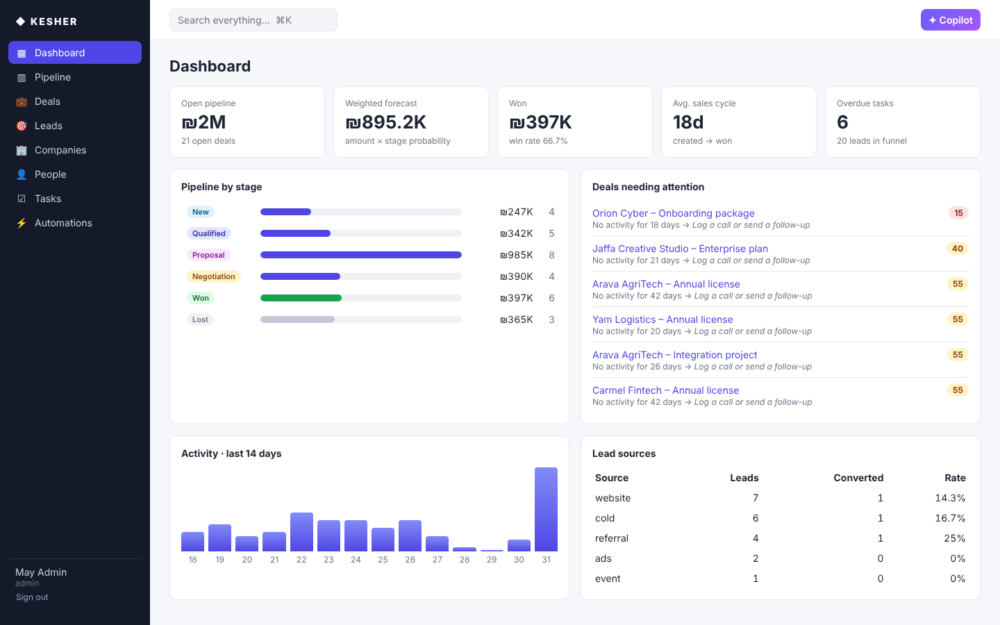
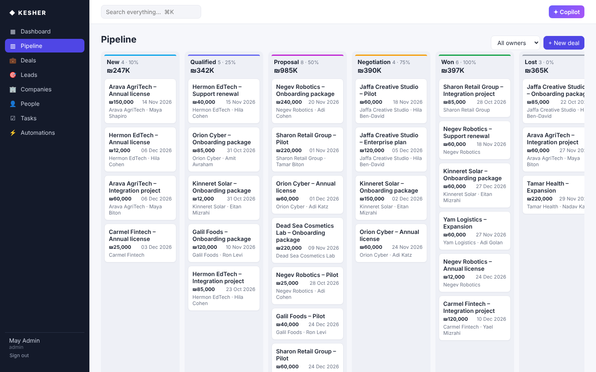
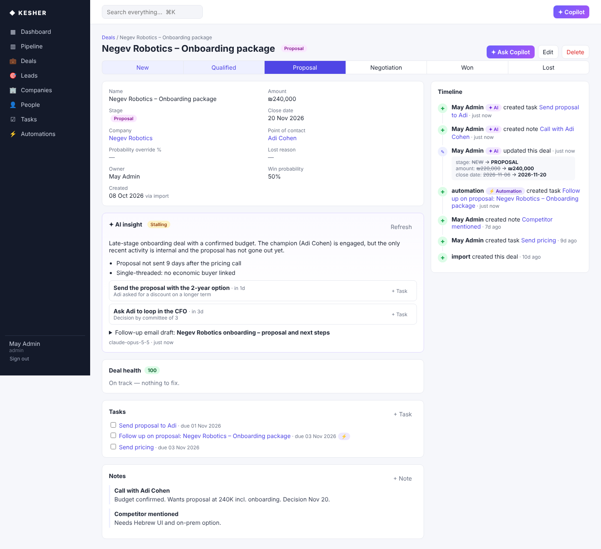
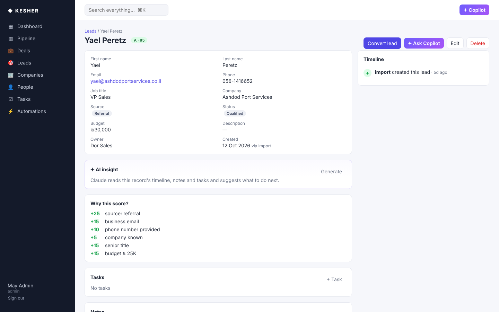
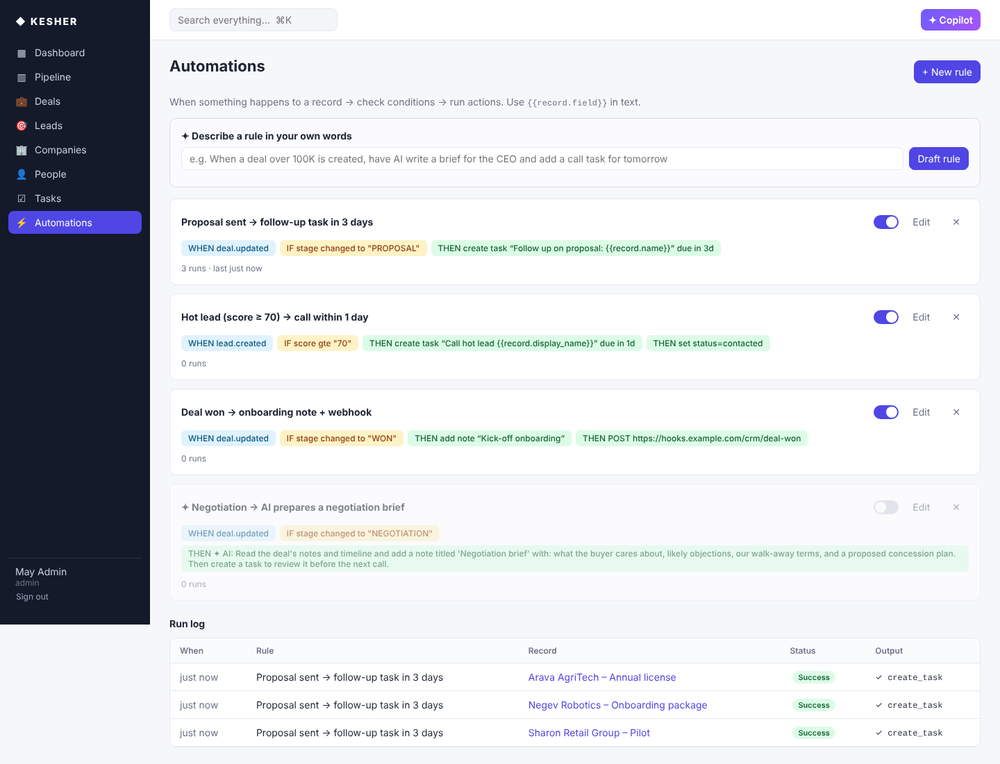
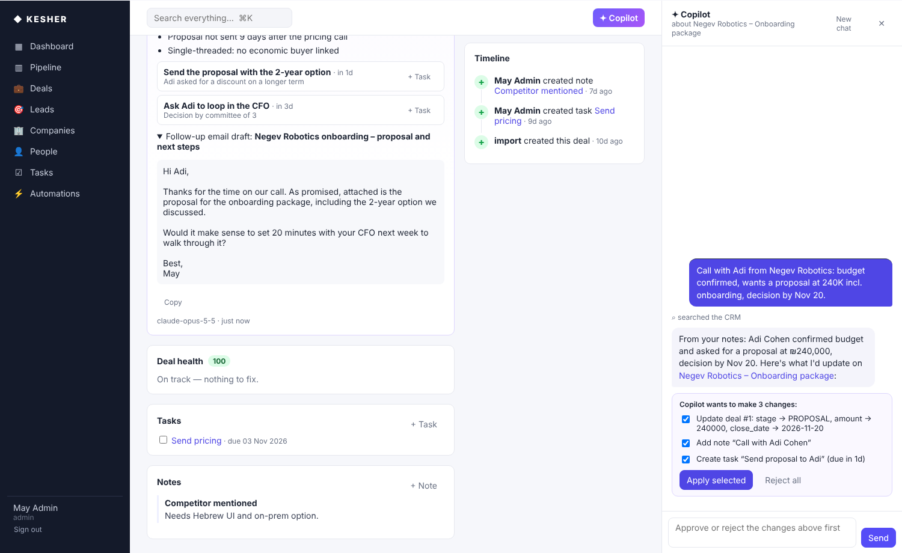
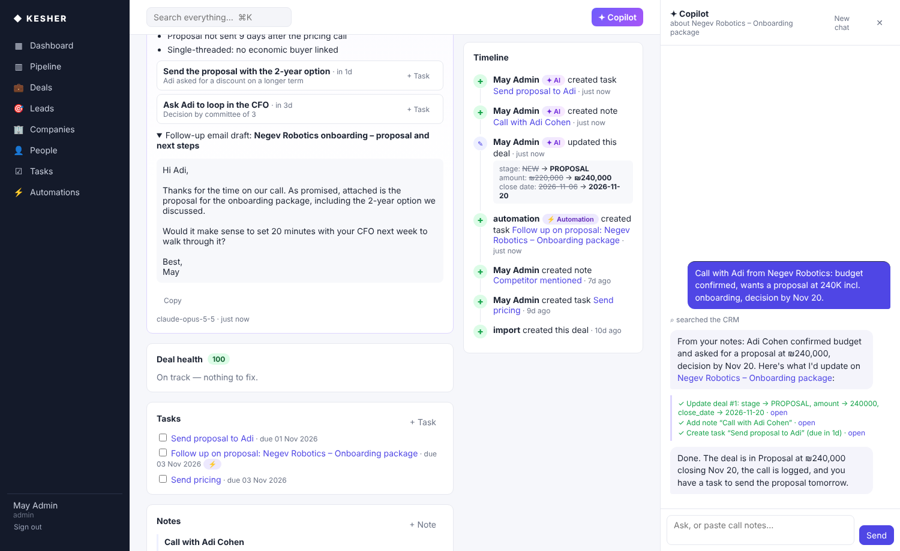
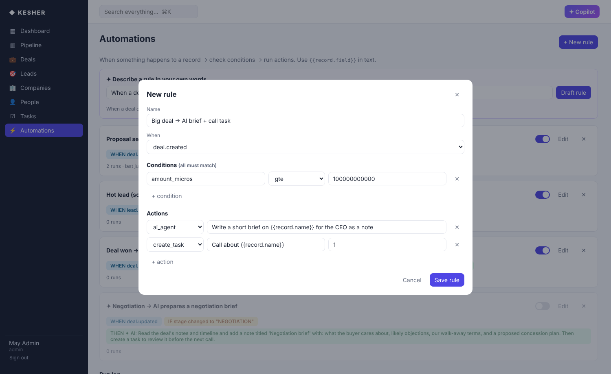

# KESHER CRM

**An AI-native sales CRM. A Claude-powered copilot works alongside the team:
it reads the CRM, turns call notes into updates, and proposes changes that run
only after you approve them. Under it is an event-driven core where every
change lands on a timeline, can trigger automations, and feeds lead scoring
and deal-health signals.**

> קשר (*kesher*) — Hebrew for "connection".



| Pipeline (drag & drop) | Deal with timeline and health |
|---|---|
|  |  |
| **Explainable lead score** | **Automation builder + run log** |
|  |  |

## AI features (Claude Opus 5.5)

| Copilot proposes, you approve | Changes applied and audited |
|---|---|
|  |  |

- **Copilot**: a chat agent with tools over the whole CRM. It can search, list, read records with their timelines, check the pipeline, and create or update records, tasks and notes, or convert leads. Reads run on their own. Every write pauses as a proposal that you approve or reject. Paste call notes and it proposes the stage change, amount, close date, a call note and a follow-up task. Opened from a record, the conversation starts with that record's context.
- **AI insight on every record**: a summary, momentum, risks grounded in the timeline, next actions you can turn into tasks in one click, and a follow-up email draft.
- **Automations in plain language**: describe a rule in English or Hebrew, and Claude drafts the trigger, conditions and actions. The engine validates the draft and you review it before saving.
- **AI automation step** (`ai_agent`): a rule can hand a record to Claude with instructions, such as "write a negotiation brief and a review task". These steps run on a background worker, so saving a record never waits for the model.
- **AI in the audit trail**: anything the AI changes shows on the timeline with a ✦ AI badge.
- **Model setup**: `claude-opus-5-5` with adaptive thinking and a set `effort` per feature (`medium` for the copilot and insights, `low` for drafting and automation steps). Tool schemas are strict, insights and rule drafts use structured outputs, refusals fall back on the server (`fallbacks: "default"`), and prompts are cached. Without an `ANTHROPIC_API_KEY` the CRM still works fully and the AI panels explain how to turn the features on.

> Screenshots of the AI panels were taken with a scripted stand-in for the model (no API key in the build environment). The request code and its shape are covered by `tests/test_ai.py`.



## Features

- **Companies, people, leads, deals, tasks, notes**: full CRUD, soft delete, sort and filter, plus global search (⌘K).
- **Kanban pipeline**: drag-and-drop between stages and within a column. Ordering uses fractional positions, so a move is one write.
- **Timeline on every record**: who changed what, with a field-level diff (`stage: NEW → PROPOSAL`). Task and note events also show up on every record they're linked to.
- **Lead conversion**: one click turns a lead into a Company, a Contact and a Deal. It reuses an existing company, and the lead's notes and tasks move to the new contact.
- **Explainable lead scoring (0–100, grades A–D)**: each point comes with a reason. The score is recomputed automatically on every edit.
- **Deal health**: flags stale deals, a passed close date, a missing contact, no next step, or a deal stuck in one stage. Each flag comes with a concrete next action, and the dashboard ranks the deals that need attention.
- **No-code automations**: rules of the form *when* `deal.updated` *if* `stage changed_to PROPOSAL` *then* create a task, add a note, update a field, or call a webhook. Text fields support `{{record.field}}` templates. There's a run log, loop protection, and per-action error isolation.
- **Dashboard**: open pipeline, weighted forecast, win rate, average sales cycle, stage funnel, lead-source conversion, and a 14-day activity chart.
- **Auth**: JWT bearer tokens, PBKDF2 password hashing, and admin/sales roles.

## Architecture

```
React (Vite, TS)  ──REST──►  FastAPI
                               │
                     services.py  ← the single write path
                               │ emits RecordEvent(name, record, actor, diff)
              ┌────────────────┼────────────────┐
         timeline.py       scoring.py      automations.py
     (activity + diff)   (lead score)   (trigger → if → then)
                               │
                     SQLAlchemy 2 · SQLite / Postgres
```

Every mutation, whether it comes from the UI, the API, an automation or the
seed import, goes through `services.py`. That module records the actor and
the diff, then emits an event. The timeline, scoring and automations are
independent subscribers, so adding a new reaction to data changes (Slack
alerts, analytics, search indexing) is one more listener. Design decisions
are written up in [docs/design.md](docs/design.md).

```
backend/app/
  models.py       domain model (money in micros, actor source, soft delete, polymorphic targets)
  services.py     CRUD + event bus + kanban positioning
  timeline.py     activity log writer with linked-record fan-out
  scoring.py      explainable lead scoring
  automations.py  rule engine (conditions, actions, templates, loop guard)
  insights.py     deal health + dashboard aggregates
  ai.py           Claude copilot agent, insights, rule drafting, background AI steps
  ai_api.py       /api/ai/* endpoints
  api.py          generic /api/{type} router + convert / move / pipeline / automations
  seed.py         deterministic demo workspace
backend/tests/    24 end-to-end API tests (incl. AI with a scripted model client)
frontend/src/     React app: dashboard, pipeline, lists, record page, automation builder
```

## Run it

**Docker**

```bash
docker compose up --build
# http://localhost:8000  ·  admin@kesher.dev / demo1234
```

**Locally**

```bash
cd frontend && npm install && npm run build && cd ..
cd backend && pip install -r requirements.txt
uvicorn app.main:app --reload            # serves API + built frontend on :8000
```

For frontend hot reload, run `npm run dev` in `frontend/`. It proxies `/api` to `:8000`.

On first start the app seeds a demo workspace: 12 companies, about 25 people, 30 deals, 20 leads, tasks, notes and 3 automation rules. Set `KESHER_SEED=off` to start empty.

| Env var | Default | Purpose |
|---|---|---|
| `KESHER_DATABASE_URL` | `sqlite:///./kesher.db` | Any SQLAlchemy URL (e.g. Postgres) |
| `KESHER_SECRET` | dev value | JWT signing key: **set in production** |
| `KESHER_WEBHOOKS` | `off` | `on` to actually POST webhook actions (otherwise dry-run, logged) |
| `KESHER_SEED` | `on` | Seed demo data on an empty DB |
| `ANTHROPIC_API_KEY` | – | Enables Copilot, insights, rule drafting and AI automation steps |
| `KESHER_AI_MODEL` | `claude-opus-5-5` | Claude model for all AI features |

## Tests

```bash
cd backend && python -m pytest -q
```

The tests cover CRUD and soft delete, timeline diffs, linked-record fan-out, kanban reordering, scoring, lead conversion (including moving notes), automations (happy path, loop protection, failing-action isolation, rule validation), dashboard math, search and seeding.

## API sketch

| Method | Path | |
|---|---|---|
| `POST` | `/api/auth/login` | → `{token}` |
| `GET/POST` | `/api/{companies,contacts,leads,deals,tasks,notes}` | list (`q`, `sort`, `filters=stage:WON`) / create (`targets` for tasks/notes) |
| `GET/PATCH/DELETE` | `/api/{type}/{id}` | detail includes related records and deal health |
| `GET` | `/api/{type}/{id}/timeline` | activity feed with diffs |
| `GET` | `/api/pipeline` · `POST /api/deals/{id}/move` | kanban |
| `POST` | `/api/leads/{id}/convert` | lead → company + contact + deal |
| `GET/POST/PATCH/DELETE` | `/api/automations` · `GET /api/automations/runs` | rules and run log |
| `GET` | `/api/dashboard` · `/api/search?q=` | analytics, global search |
| `POST` | `/api/ai/threads` · `/api/ai/threads/{id}/messages` · `/resolve` | copilot conversation, approve/reject proposals |
| `POST` | `/api/ai/insights/{type}/{id}` · `/api/ai/automation-draft` | AI insight, rule from plain language |

Interactive docs: `http://localhost:8000/docs`.

## License

MIT
