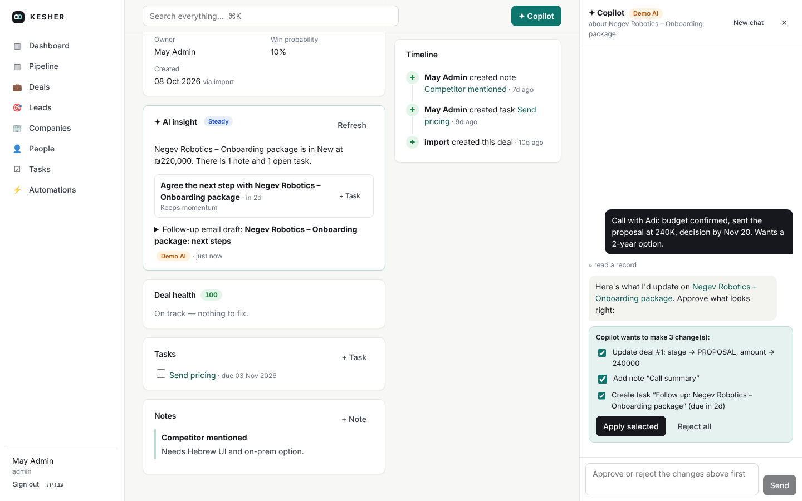
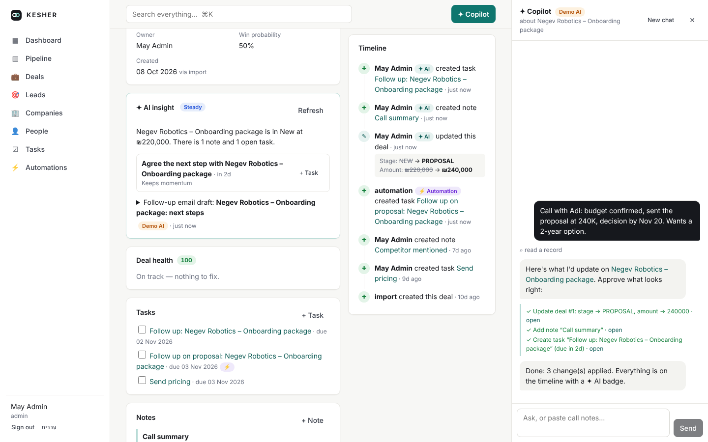
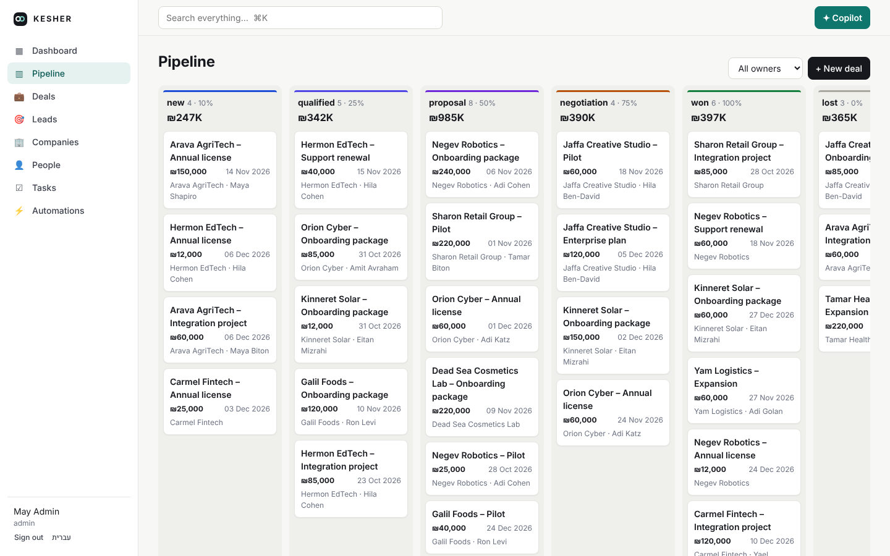
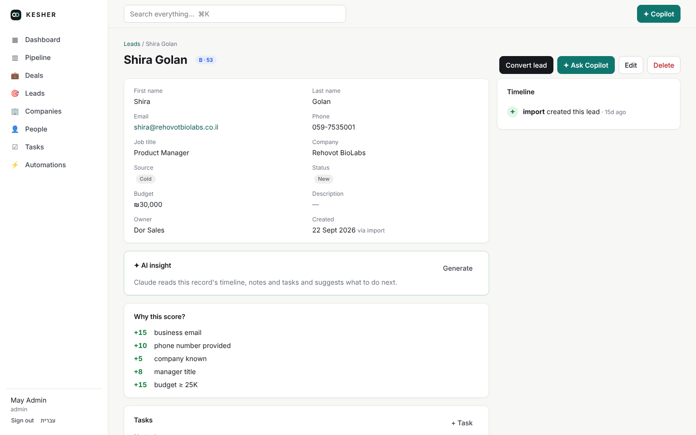
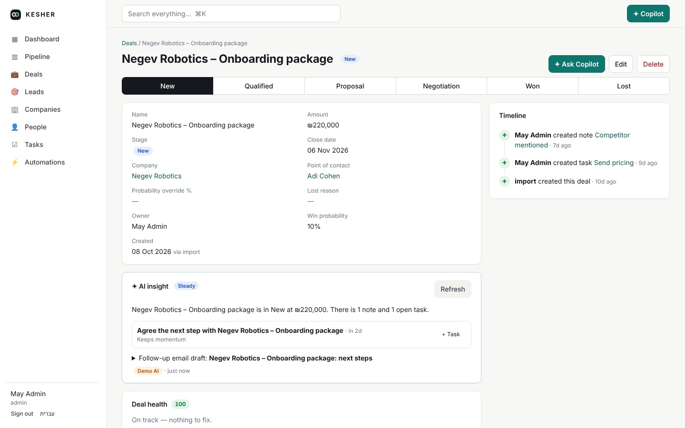
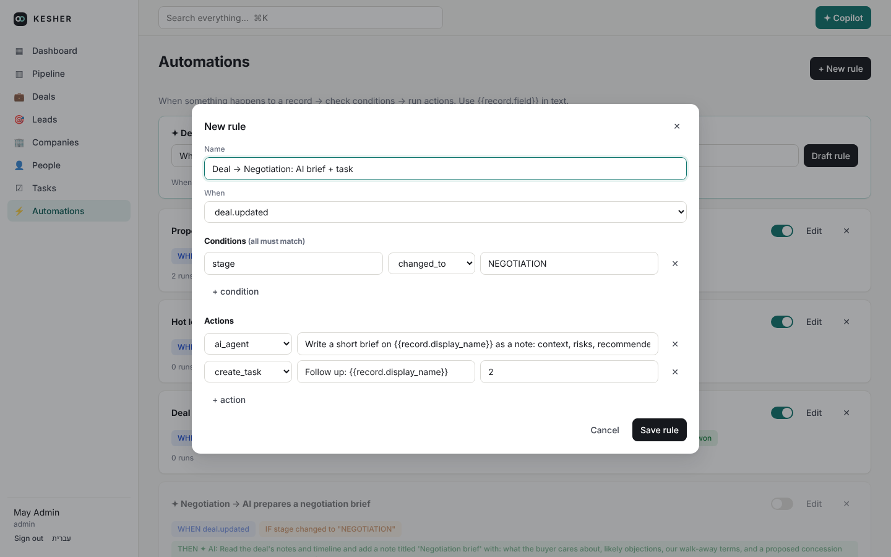
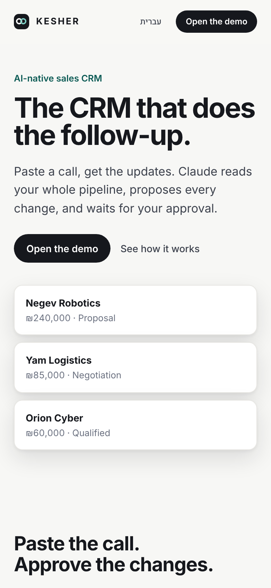

# KESHER CRM

[](https://github.com/mckova/kesher-crm/actions/workflows/ci.yml)

**An AI-native sales CRM. Paste a call, approve the updates. Claude reads the
whole pipeline, briefs you every morning, analyzes new leads before you open
them, and proposes every change, which runs only after you approve it. Under it
is an event-driven core where every change lands on a timeline, can trigger
automations, and feeds lead scoring and deal-health signals. English and
Hebrew (RTL).**

> קשר (*kesher*): Hebrew for "connection". [עברית](README.he.md)


## AI at the core (Claude Opus 5.5)


| Copilot proposes, you approve | Applied, audited, on the timeline |
|---|---|
|  |  |

- **Today's briefing**: Claude reads a snapshot of the pipeline (deal health, the largest open deals, overdue tasks, hot leads, forecast) and returns a headline and 3-5 focus items, each linked to the record it's about.
- **Copilot**: a chat agent with tools over the whole CRM. It searches, lists, reads records with their timelines and checks the pipeline on its own. Every write (create or update records, tasks, notes, lead conversion) pauses as a proposal you approve or reject. Paste call notes and it proposes the stage, amount, close date, a call note and a follow-up task. Opened from a record, it starts with that record's context.
- **Proactive analysis**: when a lead is created or a deal changes stage, an insight job is queued in the background, so the read-out is waiting when a rep opens the record.
- **AI insight on every record**: a summary, momentum, risks grounded in the timeline, next actions that become tasks in one click, and a follow-up email draft, in English or Hebrew.
- **Automations in plain language**: describe a rule in English or Hebrew, Claude drafts the trigger, conditions and actions, and the engine validates the draft before you save it.
- **AI automation step** (`ai_agent`): a rule can hand a record to Claude with instructions ("write a negotiation brief and a review task"). It runs on a background worker, so saving a record never waits on the model.
- **AI in the audit trail**: everything the AI changes shows on the timeline with a ✦ AI badge and a field-level diff.
- **Model setup**: `claude-opus-5-5` with adaptive thinking and a set `effort` per feature (`medium` for the copilot, insights and briefing, `low` for drafting and automation steps). Strict tool schemas, structured outputs via Pydantic, server-side refusal fallbacks (`fallbacks: "default"`) and prompt caching.

**Try it without an API key.** With no `ANTHROPIC_API_KEY`, KESHER runs its AI features in *demo mode*: an offline stand-in that speaks the same API shape and drives the real agent loop, approval cards, background jobs and structured outputs, using simple rules over your CRM data. Everything it produces is labelled **Demo AI**. Set a key and the same screens use Claude. The screenshots here were taken in demo mode.

## Features

| Pipeline (drag and drop) | Explainable lead score |
|---|---|
|  |  |
| **Deal with AI insight and timeline** | **Rule drafted from plain language** |
|  |  |

- **Companies, people, leads, deals, tasks, notes**: full CRUD, soft delete, sort and filter, plus global search (⌘K).
- **Kanban pipeline**: drag and drop between stages and within a column. Fractional positions make every move one write.
- **Timeline on every record**: who changed what, with a field-level diff (`stage: NEW → PROPOSAL`). Task and note events also appear on every record they're linked to.
- **Lead conversion**: one click turns a lead into a company, a contact and a deal, reusing an existing company and moving the lead's notes and tasks.
- **Explainable lead scoring (0–100, grades A–D)**: every point comes with a reason, recomputed on every edit.
- **Deal health**: flags stale deals, a passed close date, a missing contact, no next step, or a deal stuck in one stage, each with a concrete next action.
- **No-code automations**: *when* `deal.updated` *if* `stage changed_to PROPOSAL` *then* create a task, add a note, update a field, call a webhook or run an AI step. Run log, loop protection and per-action error isolation.
- **Dashboard**: open pipeline, weighted forecast, win rate, sales cycle, stage funnel, lead-source conversion and a 14-day activity chart.
- **Hebrew and English**: a full RTL interface from one stylesheet built on logical properties. Switch from the sidebar or the product page.
- **Product page**: a scroll-driven page that explains the product in five acts and ends in the sign-in form, with a static layout for reduced motion and a separate mobile composition.
- **Accessible by default**: focus-trapped dialogs, alert dialogs for destructive actions, keyboard-reachable rows and sort controls, labelled icon buttons, live regions for the copilot and skeleton loading.
- **Auth**: JWT bearer tokens, PBKDF2 password hashing, admin and sales roles.

| Hebrew, right to left | Mobile |
|---|---|
|  |  |

## Architecture

```
React (Vite, TS, en/he)  ──REST──►  FastAPI
                                      │
                            services.py  ← the single write path
                                      │ emits RecordEvent(name, record, actor, diff)
       ┌──────────────────┬───────────┼──────────────┬──────────────────────┐
  timeline.py        scoring.py   automations.py   ai.py (proactive insight jobs)
 (activity + diff)  (lead score) (trigger → if → then, ai_agent step)
                                      │
                      AI worker thread ── Claude Opus 5.5 (or demo client)
                                      │
                         SQLAlchemy 2 · SQLite / Postgres
```

Every mutation, whether it comes from the UI, the API, an automation, the AI or
the seed import, goes through `services.py`. That module records the actor and
the diff, then emits an event. The timeline, scoring, automations and the AI's
proactive analysis are independent subscribers. Design decisions are written up
in [docs/design.md](docs/design.md).

```
backend/app/
  models.py       domain model (money in micros, actor source, soft delete, polymorphic targets)
  services.py     CRUD + event bus + kanban positioning
  timeline.py     activity log writer with linked-record fan-out
  scoring.py      explainable lead scoring
  automations.py  rule engine (conditions, actions, templates, loop guard)
  insights.py     deal health + dashboard aggregates
  ai.py           copilot agent, insights, daily briefing, rule drafting, background AI jobs
  demo_ai.py      offline stand-in used when no API key is set
  ai_api.py       /api/ai/* endpoints
  api.py          generic /api/{type} router + convert / move / pipeline / automations
  seed.py         deterministic demo workspace
backend/tests/    30 end-to-end API tests (CRM, AI with a scripted client, demo mode)
frontend/src/     React app: product page, dashboard, pipeline, lists, record page, automations, copilot
```

## Run it

**Docker**

```bash
docker compose up --build
# http://localhost:8000  ·  admin@kesher.dev / demo1234
# AI runs in demo mode; export ANTHROPIC_API_KEY first to use Claude
```

**Locally**

```bash
cd frontend && npm install && npm run build && cd ..
cd backend && pip install -r requirements.txt
uvicorn app.main:app --reload            # serves API + built frontend on :8000
```

For frontend hot reload, run `npm run dev` in `frontend/`. It proxies `/api` to `:8000`.

On first start the app seeds a demo workspace: 12 companies, about 25 people, 30 deals, 20 leads, tasks, notes and automation rules. Set `KESHER_SEED=off` to start empty.

| Env var | Default | Purpose |
|---|---|---|
| `ANTHROPIC_API_KEY` | – | Turns on Claude for the copilot, insights, briefing, rule drafting and AI steps |
| `KESHER_AI` | `auto` | `auto` (Claude with a key, demo without), `on`, `demo` or `off` |
| `KESHER_AI_MODEL` | `claude-opus-5-5` | Claude model for all AI features |
| `KESHER_AI_AUTO_INSIGHTS` | `on` | Background analysis of new leads and stage changes |
| `KESHER_DATABASE_URL` | `sqlite:///./kesher.db` | Any SQLAlchemy URL (e.g. Postgres) |
| `KESHER_SECRET` | dev value | JWT signing key: **set in production** |
| `KESHER_WEBHOOKS` | `off` | `on` to actually POST webhook actions (otherwise dry-run, logged) |
| `KESHER_SEED` | `on` | Seed demo data on an empty DB |

## Tests

```bash
cd backend && python -m pytest -q
```

30 tests cover CRUD and soft delete, timeline diffs, linked-record fan-out, kanban reordering, scoring, lead conversion, automations (happy path, loop protection, failing-action isolation, validation), dashboard math, search and seeding; the AI layer with a scripted model client (tool loop, approvals and rejections, structured outputs, refusals, background steps, strict tool schemas); and demo mode end to end (copilot in English and Hebrew, insight, briefing, rule drafting, background analysis). CI runs the tests and the frontend build on every push.

## API sketch

| Method | Path | |
|---|---|---|
| `POST` | `/api/auth/login` | → `{token}` |
| `GET/POST` | `/api/{companies,contacts,leads,deals,tasks,notes}` | list (`q`, `sort`, `filters=stage:WON`) / create (`targets` for tasks/notes) |
| `GET/PATCH/DELETE` | `/api/{type}/{id}` | detail includes related records and deal health |
| `GET` | `/api/{type}/{id}/timeline` | activity feed with diffs |
| `GET` | `/api/pipeline` · `POST /api/deals/{id}/move` | kanban |
| `POST` | `/api/leads/{id}/convert` | lead → company + contact + deal |
| `GET/POST/PATCH/DELETE` | `/api/automations` · `GET /api/automations/runs` | rules and run log |
| `GET` | `/api/dashboard` · `/api/search?q=` | analytics, global search |
| `GET` | `/api/ai/status` | `{enabled, mode, model}` |
| `POST` | `/api/ai/threads` · `/api/ai/threads/{id}/messages` · `/resolve` | copilot conversation, approve or reject proposals |
| `GET/POST` | `/api/ai/briefing?lang=` · `/api/ai/insights/{type}/{id}?lang=` | daily briefing, record insight |
| `POST` | `/api/ai/automation-draft` · `GET /api/ai/jobs` | rule from plain language, background AI jobs |

Interactive docs: `http://localhost:8000/docs`.

## License

MIT
